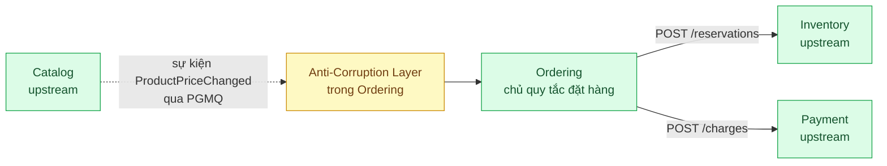

# Context Map — sàn TMĐT sau khi tách lại

Đây là hợp đồng giữa các đội. Cập nhật file này **trước** khi đổi ranh giới hoặc đổi hợp đồng sự kiện.

## Quan hệ

| Upstream | Downstream | Kiểu quan hệ | Hợp đồng | Chủ sở hữu hợp đồng |
|---|---|---|---|---|
| Catalog | Ordering | Published Language + Anti-Corruption Layer ở phía nhận | Sự kiện `ProductPriceChanged`, hàng đợi `catalog_events` | Đội Catalog |
| Inventory | Ordering | Customer/Supplier | `POST /reservations` | Đội Inventory |
| Payment | Ordering | Customer/Supplier | `POST /charges` | Đội Payment |

Inventory và Payment không biết nhau, cũng không biết Catalog. Không context nào đọc schema của context khác: mỗi context
có role PostgreSQL riêng và không có quyền trên schema còn lại.

## Một từ, nhiều mô hình

| Từ | Catalog | Ordering | Inventory | Payment |
|---|---|---|---|---|
| Sản phẩm | Tên hiển thị, mô tả, ảnh, danh mục, giá niêm yết | Tên và giá đã chốt lúc mua | SKU, tồn kho, đang giữ | Không có khái niệm này |
| Đơn hàng | Không có khái niệm này | Khách, dòng hàng, trạng thái, tổng tiền | Mã đơn trên lần đặt giữ | Mã đơn và số tiền |

## Hợp đồng `ProductPriceChanged`

| Trường | v1 | v2 | Ghi chú |
|---|---|---|---|
| Phân biệt | `eventType`, `schemaVersion: 1` | `eventType`, `schemaVersion: 2` | Luôn có |
| Định danh | `eventId`, `occurredAt`, `sku` | `eventId`, `occurredAt`, `sku` | Không đổi giữa các phiên bản |
| Tên sản phẩm | `displayName` | `title` | |
| Giá | `priceVnd` | `listPrice.amountVnd` | Số nguyên dương, đơn vị đồng |
| Thứ tự | `priceVersion` | `revision` | Tăng dần theo từng SKU, Ordering dùng để bỏ sự kiện cũ |

## Quy tắc khi đổi hợp đồng

1. Đội Catalog tăng `schemaVersion` khi đổi tên hoặc đổi nghĩa trường, và báo trước cho đội Ordering qua file này.
2. Đội Ordering thêm nhánh dịch trong `apps/ordering/acl/catalog-event-translator.ts`. Không sửa ở chỗ nào khác của Ordering.
3. Sự kiện không dịch được vào `ordering.quarantined_events`, không chặn sự kiện sau. Trong lúc đó Ordering vẫn bán bằng giá
   cũ, nên số dòng trong bảng này là chỉ số cần cảnh báo.

## Khi nào vẽ lại ranh giới

Bốn context là ranh giới của bài này, không phải đáp án cho mọi sàn. `customers` và `promotions` đang nằm trong Ordering vì
bài chưa có quy trình riêng cho chúng; khi có nghiệp vụ đủ lớn thì tách thành context riêng và cập nhật bảng trên.
