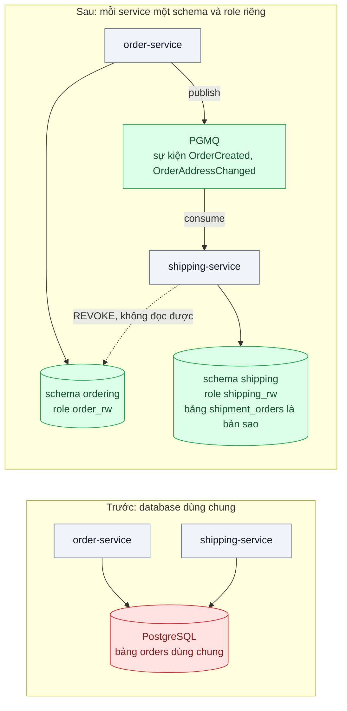
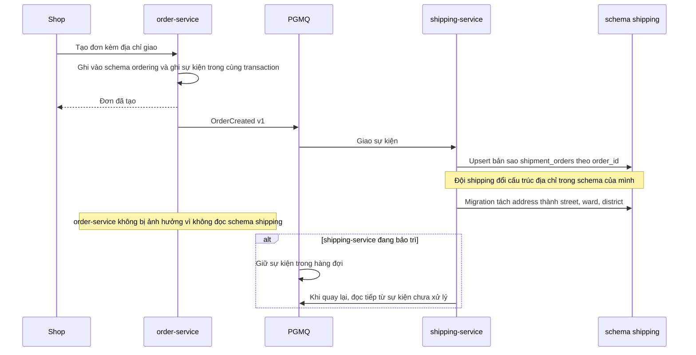

# Database per Service — Hai service cùng ghi vào một bảng, đổi schema một bên làm hỏng bên kia

| Scope | Mức độ | Trạng thái | Pattern gốc | Cập nhật |
|---|---|---|---|---|
| 07 · backend / microservices | 🟢 Cơ bản | ✅ Hoàn thành | Database per Service — Richardson, microservices.io / *Microservices Patterns* (2018); tách DB — Newman, *Monolith to Microservices* (2019) | 2026-11-04 |

> **Một câu tóm tắt:** Mỗi service sở hữu riêng dữ liệu của mình (ít nhất là schema và quyền truy cập riêng); service khác chỉ lấy dữ liệu qua API hoặc sự kiện, nên đổi cấu trúc bảng ở một bên không còn làm sập bên kia.

## 1. Bài toán thực tế (What)

**Bối cảnh** *(doanh nghiệp giả định, số liệu minh họa)*
Công ty logistics giao hàng chặng cuối, khoảng 60.000 vận đơn/ngày. Hệ thống đã tách thành `order-service` (nhận đơn từ sàn và shop) và `shipping-service` (điều phối tài xế, cập nhật trạng thái giao), nhưng cả hai vẫn đọc và ghi trực tiếp vào cùng bảng `orders` trong một database PostgreSQL dùng chung, kèm 4 bảng phụ cũng dùng chung.

**Triệu chứng người kinh doanh nhìn thấy**
- Đội shipping đổi cột `address` thành ba cột `street`, `ward`, `district` để tối ưu chia tuyến; sau khi chạy migration, `order-service` lỗi 500 trong 40 phút, shop không tạo được đơn vào giờ cao điểm.
- Báo cáo tỷ lệ giao thành công của đội shipping chạy mỗi giờ khóa bảng `orders`, thời gian tạo đơn tăng từ dưới 1 giây lên 6–8 giây đúng lúc chạy báo cáo.
- Mọi thay đổi cấu trúc dữ liệu phải họp ba đội, chờ nhau hai tuần; không ai dám xóa cột cũ nên bảng có 14 cột không còn ai dùng.

**Nguyên nhân kỹ thuật**
Database dùng chung là một kênh ghép nối ngầm: hợp đồng giữa hai service chính là cấu trúc bảng, nhưng hợp đồng đó không được khai báo, không có phiên bản, không có test. Khi một bên đổi schema, bên kia vỡ ngay lúc chạy. Tải truy vấn của hai service cũng cạnh tranh cùng khóa và cùng tài nguyên, nên báo cáo của một đội làm chậm giao dịch của đội khác.

**Ràng buộc**
- Không được dừng nhận đơn; mọi bước tách phải chạy song song với hệ đang hoạt động.
- Ngân sách hạ tầng không cho phép mỗi service một cụm database riêng ngay; chấp nhận cùng máy chủ nhưng phải cách ly được.
- Đội shipping cần một số trường của đơn hàng (mã đơn, địa chỉ, khung giờ giao) để vận hành, không thể bỏ hoàn toàn việc đọc dữ liệu đơn.

## 2. Vì sao dùng pattern này (Why)

**Nguyên nhân gốc mà pattern nhắm vào:** hai service ghép nối qua cấu trúc bảng chung — hợp đồng ngầm, không phiên bản, không kiểm tra được.

**Pattern giải quyết thế nào:** Richardson mô tả ba mức cách ly: bảng riêng cho mỗi service, schema riêng cho mỗi service, và database server riêng. Ở mọi mức, dữ liệu của một service là *riêng tư*: service khác không được truy vấn trực tiếp mà phải đi qua API của chủ sở hữu hoặc nhận bản sao qua sự kiện. Hợp đồng chuyển từ "cấu trúc bảng" sang "API và sự kiện" — thứ có thể khai báo, đánh phiên bản, test. Newman mô tả lộ trình tách database từng bước trên hệ đang chạy: tách schema, chuyển quyền sở hữu dữ liệu, đồng bộ dữ liệu trong ứng dụng, rồi mới tách máy chủ. Ở bài này chọn mức *schema riêng + role riêng* trên cùng máy chủ PostgreSQL: cách ly được quyền truy cập (bên kia không thể đọc bảng của mình) với chi phí hạ tầng bằng không, và shipping giữ một bản sao các trường cần thiết được nuôi bằng sự kiện từ order.

**Lựa chọn khác đã cân nhắc**

| Lựa chọn | Giải quyết được gì | Vì sao không chọn (ở bài này) |
|---|---|---|
| Giữ nguyên + tối ưu nhỏ (quy ước "chỉ thêm cột, không đổi cột", Expand/Contract `02` bài 08) | Giảm sự cố do đổi schema | Hợp đồng vẫn ngầm; tải báo cáo vẫn cạnh tranh với giao dịch; dựa vào kỷ luật người |
| Database View cho shipping đọc | Che cấu trúc thật của bảng `orders` | Chỉ giải quyết đọc; shipping vẫn ghi vào bảng chung; Newman coi đây là bước tạm |
| Database server riêng cho mỗi service ngay lập tức | Cách ly hoàn toàn tài nguyên và quyền | Chi phí hạ tầng và vận hành tăng ngay; chưa cần ở quy mô này, có thể nâng sau khi schema đã tách |
| Schema riêng + role riêng + bản sao qua sự kiện (chọn) | Cách ly quyền truy cập và hợp đồng; vẫn một máy chủ | Chấp nhận nhất quán cuối cho dữ liệu đơn hàng ở phía shipping |

## 3. Thiết kế hệ thống (How)

### 3.1 Kiến trúc trước và sau



### 3.2 Luồng chính



### 3.3 Thành phần và trách nhiệm

| Thành phần | Trách nhiệm | Quyết định thiết kế đáng chú ý |
|---|---|---|
| Schema `ordering` + role `order_rw` | Dữ liệu đơn hàng, chỉ `order-service` có quyền | `REVOKE ALL` với mọi role khác; test tích hợp kiểm tra bị từ chối quyền |
| Schema `shipping` + role `shipping_rw` | Vận đơn, tuyến, tài xế và bản sao `shipment_orders` | Bản sao chỉ chứa trường shipping cần; không có trường giá, thanh toán |
| Sự kiện `OrderCreated`, `OrderAddressChanged` | Hợp đồng công khai giữa hai service | Có phiên bản (`v1`), chỉ thêm trường, không đổi nghĩa trường cũ (xem `13` bài 02) |
| PGMQ | Chuyển sự kiện tin cậy, giữ lại khi consumer tắt | Nằm trong cùng Postgres nên ghi sự kiện và ghi đơn chung một transaction |
| Consumer trong `shipping-service` | Dịch sự kiện sang bản sao cục bộ, upsert theo `order_id` | Idempotent theo `order_id` và `event_id` (xem `14` bài 04) |
| API `GET /orders/:id` của order-service | Đường lấy dữ liệu đơn khi shipping cần trường ngoài bản sao | Dùng cho tra cứu lẻ, không dùng để join hàng loạt |

### 3.4 Điểm dễ sai khi triển khai
- **Tách schema nhưng vẫn cấp quyền chéo "cho tiện".** Chỉ cần một câu `GRANT SELECT` là hợp đồng ngầm quay lại. Cách tránh: quyền do migration quản lý, test tích hợp khẳng định bị từ chối.
- **Bản sao chứa quá nhiều trường.** Sao cả bảng `orders` sang shipping biến bản sao thành database dùng chung phiên bản hai. Chỉ sao trường shipping thực sự dùng.
- **Publish sự kiện ngoài transaction.** Ghi đơn xong, crash trước khi publish là mất sự kiện; đây là bài Transactional Outbox (`14` bài 03). Với PGMQ cùng database, enqueue trong cùng transaction là đủ.
- **Join chéo qua API cho báo cáo.** Báo cáo cần dữ liệu cả hai bên nên dùng bản sao hoặc kho dữ liệu báo cáo, không gọi API theo từng dòng.
- **Quên xóa cột cũ.** Sau khi shipping không còn đọc `orders.address`, phải có bước "contract" xóa cột để ngăn người sau dùng lại.
- **Tin rằng báo cáo `SELECT` khóa bảng.** Gặp khi đo: `SELECT` thường không chặn `INSERT` trong PostgreSQL, nên báo cáo thường không làm chậm tạo đơn ở cả hai bản. Triệu chứng ở mục 1 chỉ xảy ra khi có khóa tường minh như `LOCK TABLE`. Điều tra loại sự cố này phải xem `pg_locks`, đừng đổ cho "báo cáo nặng".
- **Coi tách schema là đã hết rủi ro từ báo cáo.** Khóa trên bản sao không chặn tạo đơn, nhưng chặn consumer: p95 độ trễ bản sao lên 2.268,8 ms. Sự cố chuyển từ "khách không tạo được đơn" sang "shipping thấy đơn trễ vài giây".
- **Test tính nguyên tử bằng lỗi xảy ra trước lúc gửi sự kiện.** Bản đầu của test làm `order_items` lỗi, mà bước đó đứng trước lúc gửi nên sự kiện chưa hề được gửi; phép thử âm "gửi ngoài transaction" được 0/3 test đỏ. Lỗi phải xảy ra sau lúc gửi, tức lúc commit: dùng constraint trigger `DEFERRABLE INITIALLY DEFERRED`.

## 4. Tech stack và tác động (Impact techstack)

| Lớp | Công nghệ chọn | Vì sao chọn | Thay thế tương đương |
|---|---|---|---|
| Ngôn ngữ, ứng dụng | TypeScript strict, NestJS, hai app `order-service` và `shipping-service` | Trùng stack repo; DI tách rõ repository của mỗi service | Fastify |
| Dữ liệu | PostgreSQL 16, hai schema, hai role, hai connection string | Cách ly quyền bằng chính DB, không dựa kỷ luật người | Hai database riêng, hai máy chủ riêng |
| Truy vấn | Kysely | Type-safe theo schema từng service, lộ lỗi khi trường không tồn tại | Prisma, TypeORM |
| Sự kiện | PGMQ | Cùng Postgres nên có transaction chung với ghi đơn; không thêm hạ tầng | NATS JetStream, RabbitMQ, Kafka |
| Migration | SQL thuần theo thư mục từng service | Mỗi service tự chạy migration của schema mình | Kysely migrator |
| Hạ tầng local | Docker Compose | Một Postgres có PGMQ, hai app | — |
| Test, đo | Vitest, k6 | Vitest cho quyền và idempotency; k6 đo tạo đơn khi shipping chạy báo cáo | — |

**Thay đổi so với hệ thống hiện tại:** thêm hai schema và hai role, chuyển bảng về chủ sở hữu, thêm hàng đợi sự kiện và consumer ở shipping, thêm bản sao `shipment_orders`; đội vận hành phải theo dõi độ trễ hàng đợi (consumer lag) như một chỉ số mới và chấp nhận dữ liệu đơn ở shipping trễ vài giây.

**Ghi chú khi làm lab**
- Phiên bản: NestJS 10.4.22, Kysely 0.29.6, `pg` 8.23.1, TypeScript 5.9.3, Vitest 5.0.3, esbuild 0.28.2, `ghcr.io/pgmq/pg16-pgmq:v1.13.0` (PostgreSQL 16.15), k6 `grafana/k6:1.4.2`.
- Role `order_rw` và `shipping_rw` vừa là role chạy app vừa là chủ schema, nên mỗi service tự chạy migration của mình. Môi trường thật nên tách role migration và role app như bài 17/05; lab gộp lại để giữ gọn.
- Hàng đợi là bề mặt ghi chung duy nhất. Quyền được cấp hẹp theo vai: `order_rw` chỉ gửi, `shipping_rw` chỉ đọc và archive, nên chỉ số "số bảng được hơn một service ghi" không tính schema `pgmq`.
- Mỗi sự kiện mang đủ trường cùng `orderVersion`, nên bên nhận giữ bản mới nhất mà không cần sự kiện đúng thứ tự, cũng không cần bảng `event_id`. Khác với mục 3.3, idempotent ở đây dựa trên `order_id` và phiên bản.
- Báo cáo có hai chế độ: `plain` chỉ đọc, `lock` giữ `SHARE` lock trên bảng trong lúc đọc, để tách bạch tác động của truy vấn nặng và của khóa.
- Bản "trước" chạy migration bằng superuser, vì database dùng chung thường có một người giữ quyền đổi cấu trúc.

## 5. Kết quả đầu ra và cách đo (Output impact)

| Chỉ số | Trước (minh họa) | Mục tiêu khi thực hành | Cách đo |
|---|---|---|---|
| Số bảng được hơn một service ghi | 5 | 0 | Truy vấn `information_schema.role_table_grants`, so với danh sách chủ sở hữu |
| Lỗi ở `order-service` khi shipping đổi schema | 500 trong 40 phút | 0 lỗi | Test tích hợp: chạy migration shipping trong khi k6 tạo đơn liên tục |
| p95 tạo đơn khi shipping chạy báo cáo nặng | 6.000 ms | ≤ 300 ms | k6 tạo đơn 30 request/giây, đồng thời chạy báo cáo trên schema shipping |
| Độ trễ từ tạo đơn tới khi bản sao ở shipping có dữ liệu | — | p95 ≤ 2 giây | Timestamp sự kiện so với timestamp upsert, ghi log có correlation id |
| Quyền truy cập chéo | có | bị từ chối | Test tích hợp dùng role `shipping_rw` đọc `ordering.orders`, kỳ vọng lỗi quyền |

> Số "trước" là minh họa để hình dung bài toán. Số "mục tiêu" chỉ được coi là đạt khi có số đo thật
> ở mục 8 kèm môi trường đo.

**Tác động nghiệp vụ mong đợi:** đội shipping đổi mô hình dữ liệu theo nhịp của mình mà không gây sự cố nhận đơn; báo cáo không còn làm chậm việc tạo đơn; thời gian họp phối hợp đổi schema giữa các đội giảm.

### 5.1 Số đã đo

**Môi trường** (đo ngày 2026-11-04): Apple M5, 10 nhân, 32 GB RAM, macOS (Darwin 25.6.0), chạy pin, mở nắp, không có khoảng ngủ. Docker Desktop 29.9.2, Compose v5.6.1, máy ảo Docker 10 CPU và 7,75 GiB RAM. PostgreSQL 16.15, PGMQ 1.13.0, service trên `node:20-alpine` (Node 20.20.2), k6 1.4.2. Service, database và k6 chạy cùng mạng Compose. Load 1 phút của macOS: 1,1 – 3,4.

**Tải:** seed đúng 100.000 đơn như mục 8, mô hình mở 30 request/giây trong 2 phút mỗi kịch bản. Hai bản dựng từ volume sạch, chạy tuần tự. Báo cáo chạy 4 lần mỗi phút, mỗi lần khoảng 2,8 – 3,0 giây. Không rớt iteration nào.

| Chỉ số | Trước | Sau | Mục tiêu | Kết luận |
|---|---|---|---|---|
| Số bảng được hơn một service ghi | 5 | 0 | 0 | Đạt, đọc từ `information_schema.role_table_grants` |
| Lỗi ở `order-service` khi shipping đổi schema | 1.193/1.800 đơn lỗi, mọi đơn sau migration | 0/1.801 | 0 lỗi | Đạt |
| p95 tạo đơn khi báo cáo thường chạy | 5,2 ms | 5,2 ms | ≤ 300 ms | Đạt, nhưng bản trước cũng đạt: báo cáo thường không chặn ghi |
| p95 tạo đơn khi báo cáo giữ khóa | 2.267,0 ms | 4,2 ms | ≤ 300 ms | Đạt |
| Độ trễ bản sao, p95 khi không có khóa | không áp dụng | 108,2 ms (không báo cáo), 107,2 ms (báo cáo thường) | ≤ 2 giây | Đạt |
| Độ trễ bản sao, p95 khi báo cáo giữ khóa | không áp dụng | 2.268,8 ms, lớn nhất 2.951,5 ms | ≤ 2 giây | **Không đạt** |
| Quyền truy cập chéo | có | bị từ chối (42501) | bị từ chối | Đạt, 6 kịch bản trong `test/cross-schema-access-denied.test.ts` |

**Độ trễ tạo đơn chi tiết** (lượt chính, đơn vị ms):

| Kịch bản | Bản | p50 | p95 | p99 | Lớn nhất |
|---|---|---|---|---|---|
| Không báo cáo | Trước | 3,6 | 5,2 | 6,4 | 18,7 |
| Không báo cáo | Sau | 4,0 | 6,0 | 8,6 | 77,5 |
| Báo cáo thường | Trước | 3,3 | 5,2 | 7,8 | 37,4 |
| Báo cáo thường | Sau | 3,2 | 5,2 | 6,0 | 17,6 |
| Báo cáo giữ khóa | Trước | 3,9 | 2.267,0 | 2.861,1 | 3.304,4 |
| Báo cáo giữ khóa | Sau | 2,7 | 4,2 | 5,1 | 15,5 |

**Ba vòng 60 giây, xoay thứ tự** (p95 tạo đơn, đơn vị ms, 1.800 – 1.801 đơn mỗi lượt):

| Vòng | Thứ tự chạy | Trước: không báo cáo / báo cáo thường | Sau: không báo cáo / báo cáo thường |
|---|---|---|---|
| 1 | sau, trước | 4,5 / 4,1 | 4,7 / 4,3 |
| 2 | trước, sau | 4,4 / 4,2 | 4,8 / 4,2 |
| 3 | sau, trước | 4,5 / 4,0 | 4,8 / 4,2 |

**Migration của shipping giữa lúc tạo đơn** (lượt 60 giây, migration chạy ở giây thứ 20, bảng 100.000 dòng):

| | Trước | Sau |
|---|---|---|
| Thời gian chạy migration | 462 ms | 311 ms |
| Đơn thành công / lỗi | 607 / 1.193 | 1.801 / 0 |
| Sự kiện chờ khi shipping bản cũ gặp lỗi | không áp dụng | 1.209 |
| Thời gian từ lúc deploy shipping bản mới tới khi hết hàng đợi | không áp dụng | 5.296 ms |
| Đơn thiếu trong bản sao sau khi bắt kịp | không áp dụng | 0 |

**Đọc số này thế nào**
- Triệu chứng "báo cáo làm chậm tạo đơn" chỉ tái hiện được khi báo cáo giữ khóa. Báo cáo thường không làm chậm ở cả hai bản: chênh lệch nằm trong mức nhiễu, kể cả p95 thấp hơn đôi chút vì kịch bản không báo cáo chạy trước, lúc service còn nguội. Tách schema không phải cách duy nhất chữa lỗi này: bỏ `LOCK TABLE` cũng hết, và rẻ hơn.
- Lợi ích khó thay thế nhất của pattern là khoanh vùng sự cố đổi schema: 1.193 đơn lỗi so với 0, và phía shipping tự bắt kịp mà không mất sự kiện.
- Khóa trên bản sao không biến mất mà chuyển thành độ trễ bản sao, và vượt mục tiêu 2 giây. Muốn đạt thì báo cáo không nên giữ khóa trên bảng consumer đang ghi.
- Thời gian bắt kịp 5.296 ms gồm thời gian dựng lại container và visibility timeout 5 giây của lần đọc lỗi trước, chưa tách riêng được từng phần.
- Độ trễ bản sao khoảng 60 ms ở p50 chủ yếu đến từ chu kỳ đọc 100 ms của consumer.

**Test:** 26/26 đạt trên PostgreSQL và PGMQ thật. `node scripts/kiem-chung-lab.mjs` đạt 6/6 bước từ volume sạch.

**Phép thử âm** (`pnpm bench:drills`, số test đỏ trên số test của file bảo vệ phần đó):

| Gỡ phần nào của pattern | Test đỏ | Test nào đỏ |
|---|---|---|
| Cấp quyền chéo: `shipping_rw` đọc được bảng đơn | 1/10 | `shipping_rw` đọc bảng đơn bị từ chối |
| Bản sao chép thêm trường giá | 1/10 | Bản sao không có trường giá |
| Gửi sự kiện ngoài transaction ghi đơn | 1/3 | Lỗi lúc commit thì sự kiện đã gửi cũng mất theo |
| Bỏ điều kiện phiên bản khi ghi bản sao | 1/7 | Sự kiện cũ tới muộn không kéo địa chỉ về bản trước |
| Archive sự kiện trước khi xử lý | 1/2 | Shipping bản mới bắt kịp mọi sự kiện đã chờ |

**Hạn chế:** mọi thứ chung một máy và một PostgreSQL, nên lab không đo được hai service tranh CPU, bộ nhớ, I/O khi máy chủ gần bão hòa: máy đo có 10 nhân và báo cáo chỉ chiếm vài nhân trong vài giây. Mức cách ly của bài là schema và role, không phải tài nguyên. Mỗi kịch bản có một lượt 2 phút; ba vòng 60 giây chỉ gồm hai kịch bản không có khóa. Chạy pin, cùng nguồn điện cho cả hai bản.

## 6. Đánh đổi và khi KHÔNG nên dùng

**Đánh đổi**
- Mất khả năng join và transaction xuyên service; truy vấn tổng hợp phải qua bản sao, API Composition (bài 05) hoặc CQRS (`02` bài 06).
- Dữ liệu nhân bản có độ trễ; phải có xử lý trùng và thứ tự sự kiện (`14` bài 04, 06).
- Nhiều schema, nhiều migration pipeline hơn để vận hành; cần quy ước đặt tên và quyền rõ ràng.

**Không nên dùng khi**
- Hai "service" thực ra luôn thay đổi cùng nhau: đó là một service bị cắt đôi, nên gộp lại (bài 01).
- Nghiệp vụ đòi tính nhất quán mạnh giữa hai tập dữ liệu trong mọi truy vấn và không chấp nhận độ trễ: giữ chung database và chung service cho phần đó.
- Đội nhỏ chưa có hạ tầng sự kiện và quan sát: chi phí vận hành bản sao vượt lợi ích.

**Liên quan**
- Đọc trước: `../01-decomposition-bounded-context-tach-service-theo-nghiep-vu/` — ranh giới đúng rồi mới tách dữ liệu.
- Đọc sau: `../../14-backend-queueing/03-transactional-outbox-ghi-don-xong-crash-mat-event/`, `../../14-backend-queueing/04-idempotent-consumer-event-den-hai-lan-tru-kho-hai-lan/`.
- Cùng chủ đề: `../../02-backend-database/08-expand-contract-doi-ten-cot-100-trieu-dong/` — đổi schema an toàn trong một service; `../05-api-composition-man-hinh-don-hang-can-du-lieu-4-service/` — ghép dữ liệu khi không còn join.

## 7. Cơ sở tham khảo

- Chris Richardson, "Pattern: Database per service", microservices.io — https://microservices.io/patterns/data/database-per-service.html — ba mức cách ly (bảng, schema, server), lợi ích và hậu quả cho truy vấn và transaction.
- Chris Richardson, *Microservices Patterns*, Manning, 2018 — chương về quản lý dữ liệu phân tán, lý do dữ liệu riêng là điều kiện để service tiến hóa độc lập.
- Sam Newman, *Monolith to Microservices*, O'Reilly, 2019 — chương "Decomposing the Database": Shared Database, Database View, Synchronize Data in Application, Split Table; lộ trình tách từng bước trên hệ đang chạy.
- PostgreSQL docs, "Schemas" và "GRANT" — https://www.postgresql.org/docs/ — cơ chế cách ly quyền dùng ở mục 3.
- PGMQ — https://github.com/pgmq/pgmq — hàng đợi trong Postgres cho sự kiện giữa hai service.

## 8. Kế hoạch thực hành

- [x] Bước 1: dựng Postgres có PGMQ, hai NestJS app cùng ghi bảng `orders` chung; seed 100.000 đơn; viết báo cáo nặng ở shipping.
- [x] Bước 2: đo "trước": k6 tạo đơn 30 request/giây trong khi chạy báo cáo; chạy migration đổi cột `address` ở shipping và ghi số lỗi của order-service.
- [x] Bước 3: tạo schema `ordering`, `shipping` và hai role; chuyển bảng; thêm sự kiện `OrderCreated` qua PGMQ trong cùng transaction; viết consumer upsert `shipment_orders`; `REVOKE` quyền chéo.
- [x] Bước 4: đo "sau" cùng kịch bản; ghi số thật và môi trường vào mục 5.
- [x] Bước 5: test: (a) role shipping đọc schema ordering bị từ chối; (b) migration shipping không gây lỗi order; (c) sự kiện tới hai lần chỉ upsert một bản sao; (d) consumer tắt rồi mở lại vẫn nhận đủ sự kiện.

**Cấu trúc code**
```text
apps/
  truoc/                          # hai app dùng chung 5 bảng trong schema shared
  order-service/
    migrations/                   # schema ordering, chạy bằng role order_rw
    order-service.module.ts       # [PATTERN] ghi đơn và gửi sự kiện cùng transaction
    published-event.ts            # hợp đồng công khai, tách khỏi tên cột
  shipping-service/
    migrations/                   # [PATTERN] bản sao chỉ có trường shipping cần; 002 tách address
    order-event.consumer.ts       # [PATTERN] upsert theo order_id, chỉ phiên bản mới hơn được ghi đè
    order-event-translator.ts     # dịch sự kiện sang mô hình của shipping
    shipping-service.module.ts    # API và báo cáo
libs/platform/                    # log, correlation id, kết nối Kysely, chạy migration
db/init/                          # role, schema, hàng đợi và bản "trước"
db/seed.sql                       # 100.000 đơn cho lượt đo
scripts/migrate.ts                # mỗi service tự chạy migration bằng role của mình
test/
  cross-schema-access-denied.test.ts
  shipping-migration-does-not-break-orders.test.ts
  duplicate-event-upserts-once.test.ts
  consumer-restart-receives-all-events.test.ts
  event-and-order-commit-together.test.ts
  report-lock-does-not-block-orders.test.ts
bench/
  orders-during-report.k6.js
  run-scenario.ts                 # đo một bản: đối chứng, báo cáo thường, báo cáo giữ khóa, migration
  negative-drills.ts
docker-compose.yml                # postgres; profile truoc, sau, bench
```

**Cách chạy** *(chỉ cần Docker; k6 chạy trong container)*
```bash
pnpm install                 # tự gói dist/*.cjs
docker compose up -d --wait  # chỉ dựng PostgreSQL có PGMQ
pnpm typecheck && pnpm test  # test tự dựng lại schema bằng migration của từng service
pnpm bench:drills            # phép thử âm, cần PostgreSQL đang chạy
docker compose down -v

# Đo hai bản, mỗi lệnh khoảng 7 phút và tự dọn sau khi xong
pnpm bench:scenario --variant truoc --run main
pnpm bench:scenario --variant sau --run main
```

## Bài học sau khi làm

- Triệu chứng trong đề bài chỉ đúng một nửa. "Báo cáo khóa bảng" không phải do `SELECT`, mà do khóa tường minh; báo cáo thường không làm chậm tạo đơn ở bản nào. Nếu dàn cảnh để bản "trước" chậm rồi quy công cho pattern thì sẽ kết luận sai, nên lab đo cả hai chế độ.
- Lợi ích thật của pattern là khoanh vùng sự cố đổi schema: 1.193 đơn lỗi so với 0, sự kiện chờ trong hàng đợi và không mất đơn nào.
- Pattern không xóa rủi ro mà đổi chỗ của nó. Khóa trên bản sao không làm khách lỗi nhưng làm bản sao trễ quá mục tiêu, và sau migration shipping bản cũ ngừng xử lý tới khi deploy bản mới. Vì vậy độ trễ hàng đợi phải thành chỉ số vận hành.
- Phép thử âm bắt được một test xanh giả của chính bài: test "ghi đơn lỗi thì không có sự kiện" làm lỗi ở bước trước lúc gửi nên không chứng minh gì. Đổi sang lỗi lúc commit mới bắt được việc gửi ngoài transaction.
- Hạn chế: mức cách ly là schema và role trên một máy chủ, nên hai service vẫn chung CPU, bộ nhớ và I/O. Tách máy chủ là bước sau và cần Transactional Outbox (14/03), vì `pgmq.send` cùng transaction chỉ làm được khi chung một PostgreSQL.
