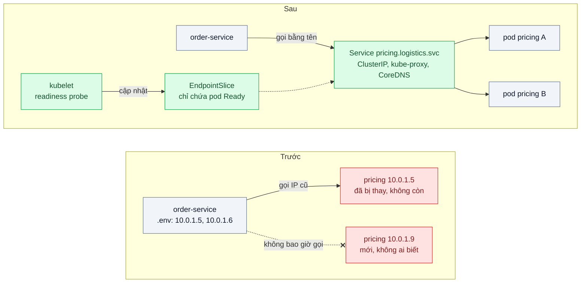
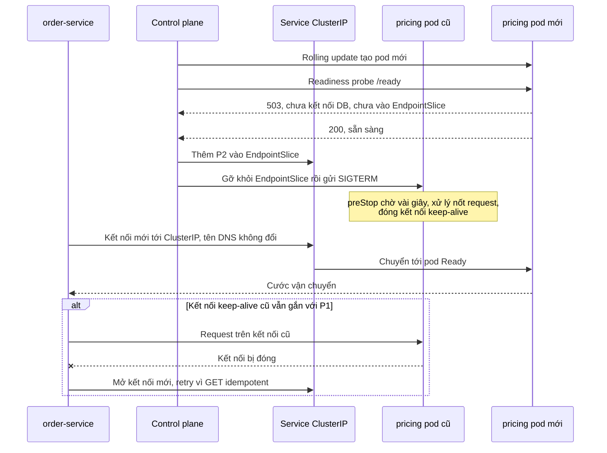

# Service Discovery — Service deploy lại đổi IP, các service khác gọi vào địa chỉ cũ

| Scope | Mức độ | Trạng thái | Pattern gốc | Cập nhật |
|---|---|---|---|---|
| 07 · backend / microservices | 🟡 Trung bình | ✅ Hoàn thành | Service Registry, Client-side / Server-side Discovery — Richardson, microservices.io | 2026-11-04 |

> **Một câu tóm tắt:** Thay danh sách IP cứng trong file cấu hình bằng cơ chế discovery: instance được đăng ký và gỡ tự động theo health check, phía gọi dùng một tên ổn định (Kubernetes Service DNS) — để deploy và scale không còn cần ai sửa cấu hình bằng tay.

## 1. Bài toán thực tế (What)

**Bối cảnh** *(doanh nghiệp giả định, số liệu minh họa)*
Công ty logistics có 9 service chạy bằng Docker trên máy ảo, deploy bằng script. `order-service` gọi `pricing-service` (tính cước) và `tracking-service` qua danh sách IP ghi trong `.env`. Mỗi tuần 10–15 lần deploy; mùa cao điểm cuối năm thêm máy ảo cho `tracking-service`. Công ty đang chuyển dần sang Kubernetes.

**Triệu chứng người kinh doanh nhìn thấy**
- Sau mỗi lần deploy `pricing-service`, 3–5 phút đơn mới báo "không tính được cước" cho tới khi có người sửa IP và khởi động lại phía gọi; vì vậy deploy phải làm ngoài giờ và cần hai người.
- Thêm 2 máy cho `tracking-service` mùa cao điểm nhưng máy mới không nhận request nào vì không ai cập nhật danh sách ở phía gọi.
- Một máy chết lúc 2 giờ sáng, phía gọi vẫn chia request vào nó: cứ 3 request có 1 lỗi cho tới khi trực ca thức dậy.

**Nguyên nhân kỹ thuật**
Vị trí mạng (IP:port) của instance là động — đổi khi deploy, scale, hỏng — nhưng phía gọi coi nó là cấu hình tĩnh. Không có nguồn sự thật về "instance nào đang sống và sẵn sàng". Thêm một lớp khó thấy: kết nối HTTP keep-alive và cache DNS phía client tiếp tục trỏ vào instance cũ ngay cả khi địa chỉ đã được cập nhật ở nơi khác.

**Ràng buộc**
- Không sửa code nghiệp vụ của từng service; chỉ đổi cách phân giải địa chỉ, health endpoint và cấu hình.
- Instance đang khởi động hoặc đang tắt không được nhận request.
- Trong giai đoạn chuyển đổi, vài service còn chạy trên máy ảo nhưng phía gọi phải dùng chung một kiểu tên.
- Đội vận hành 4 người, không muốn vận hành thêm một cụm registry riêng nếu nền tảng đã có sẵn.

## 2. Vì sao dùng pattern này (Why)

**Nguyên nhân gốc mà pattern nhắm vào:** phía gọi tự giữ thông tin vị trí của phía được gọi, trong khi thông tin đó thay đổi liên tục và chỉ nền tảng triển khai mới biết chính xác.

**Pattern giải quyết thế nào:** microservices.io tách bài toán thành hai nửa. *Service Registry* là cơ sở dữ liệu các instance đang sống; instance được đưa vào bằng *self registration* (tự đăng ký và gửi heartbeat) hoặc *3rd party registration* (nền tảng đăng ký thay, dựa trên health check). Phía gọi tìm instance bằng *client-side discovery* (hỏi registry rồi tự cân bằng tải) hoặc *server-side discovery* (gọi một địa chỉ ổn định, router tra registry thay). Kubernetes có sẵn cả hai nửa: EndpointSlice là registry, kubelet cùng readiness probe là đăng ký bên thứ ba, Service ClusterIP với kube-proxy là server-side discovery, CoreDNS cấp tên ổn định `pricing.logistics.svc.cluster.local`; headless Service trả thẳng danh sách IP pod cho client-side discovery khi cần (kết nối HTTP/2, gRPC lâu dài).

**Lựa chọn khác đã cân nhắc**

| Lựa chọn | Giải quyết được gì | Vì sao không chọn (ở bài này) |
|---|---|---|
| Giữ nguyên + tối ưu nhỏ (script deploy tự sửa `.env` và khởi động lại phía gọi) | Bớt thao tác tay | Khởi động lại dây chuyền mỗi lần deploy; vẫn không phát hiện instance chết |
| Load balancer cố định (NGINX) trước mỗi service | Một địa chỉ ổn định cho phía gọi | Vẫn phải cập nhật upstream khi đổi; tự cấu hình health check; thêm một hop |
| Registry riêng (Consul) + client-side discovery | Chạy cả máy ảo lẫn container, health check phong phú | Thêm một cụm phải vận hành; dư thừa khi đã lên Kubernetes — giữ làm phương án cho phần còn ở máy ảo |
| Kubernetes Service + DNS + readiness probe (chọn) | Đăng ký và gỡ tự động theo probe, tên ổn định, cân bằng tải sẵn | Chỉ trong cluster; kết nối lâu dài cần xử lý riêng; probe phải viết đúng |

## 3. Thiết kế hệ thống (How)

### 3.1 Kiến trúc trước và sau



### 3.2 Luồng chính



### 3.3 Thành phần và trách nhiệm

| Thành phần | Trách nhiệm | Quyết định thiết kế đáng chú ý |
|---|---|---|
| EndpointSlice (registry) | Danh sách IP pod đang Ready của mỗi Service | Không ai sửa tay; nguồn sự thật do control plane giữ |
| kubelet + readiness probe | Đăng ký bên thứ ba: chỉ đưa pod vào khi `/ready` trả 200 | `/ready` kiểm kết nối DB của chính service, không kiểm phụ thuộc downstream |
| Service ClusterIP + kube-proxy + CoreDNS | Server-side discovery: một tên DNS và một IP ảo, chia kết nối tới pod Ready | Phía gọi chỉ biết tên; cân bằng theo *kết nối*, không theo request |
| Headless Service | Trả danh sách IP pod cho client-side discovery | Dùng cho kết nối HTTP/2 lâu dài cần cân bằng theo request |
| preStop + `terminationGracePeriodSeconds` | Gỡ êm: chờ EndpointSlice lan tới mọi node trước khi tắt | Phối hợp với graceful shutdown ở ứng dụng |

### 3.4 Điểm dễ sai khi triển khai
- **Readiness kiểm quá ít hoặc quá nhiều.** Chỉ trả 200 khi process sống thì pod nhận traffic trước khi kết nối DB; kiểm cả phụ thuộc downstream thì một phụ thuộc chậm làm mọi pod bị gỡ cùng lúc.
- **Gộp liveness với readiness.** Liveness fail thì pod bị khởi động lại; dùng nhầm sẽ biến "tạm quá tải" thành "khởi động lại dây chuyền".
- **Không có preStop.** Pod tắt ngay khi nhận SIGTERM, trước khi mọi node cập nhật EndpointSlice: vài giây request rơi vào pod đã chết.
- **Kết nối lâu dài.** kube-proxy chia theo kết nối, nên pod mới scale ra không nhận tải từ client đang giữ keep-alive hay HTTP/2; giới hạn tuổi kết nối, dùng headless Service với cân bằng phía client, hoặc dùng mesh.
- **Thời hạn request không che phần chờ kết nối.** `signal` của `undici` chỉ hủy được request đã ghi xuống socket; request còn xếp hàng chờ kết nối vẫn treo tới connect timeout, mặc định 10 giây. Lần đo thử đầu tiên, khi gọi tới IP của pod đã xóa, `order` im lặng hơn 5 giây dù đã đặt thời hạn 1 giây. Phải đặt `connect.timeout` riêng. Đồng hồ của tùy chọn này thô: đặt 300 ms thì đo được khoảng 1 giây.
- **Sửa `clusterIP` bằng `apply`.** Trường này không đổi được, nên bỏ `clusterIP: None` khỏi manifest rồi apply thì Service vẫn headless. Phép thử âm lần đầu "không đỏ" vì lý do này, không phải vì test hỏng. Muốn đổi phải xóa Service.
- **Cache DNS ở thư viện.** `dns.lookup` của Node.js dùng bộ phân giải hệ điều hành mỗi lần gọi, nhưng một số thư viện hoặc agent tự cache; kiểm tra trước khi tin rằng "DNS đã đổi".

## 4. Tech stack và tác động (Impact techstack)

| Lớp | Công nghệ chọn | Vì sao chọn | Thay thế tương đương |
|---|---|---|---|
| Nền tảng | Kubernetes chạy local bằng k3s `v1.33.5-k3s1` trong một container Compose, một node (kế hoạch ban đầu là kind hoặc k3d, xem ghi chú dưới bảng) | Registry, đăng ký theo probe, Service, DNS có sẵn — không thêm cụm riêng; máy chỉ cần Docker | kind, k3d, Nomad + Consul |
| Ứng dụng | TypeScript strict, Fastify cho `order-service` và `pricing-service` tối giản | Bài nhỏ, chỉ cần health endpoint và một API | NestJS + `@nestjs/terminus` |
| HTTP client | `undici` 7.30.1 `Pool` với `clientTtl` (tuổi tối đa của kết nối) và `connect.timeout`, đã đọc mã nguồn thư viện | Giúp pod mới nhận tải khi client giữ keep-alive | `http.Agent` của Node |
| Phần còn ở máy ảo | Service không selector + EndpointSlice khai báo tay | Phía gọi dùng cùng kiểu tên DNS trong giai đoạn chuyển đổi | Consul + consul-k8s |
| Tải và sự cố | k6 chạy liên tục trong lúc `kubectl rollout restart`, scale, làm readiness fail bằng cờ | Đo lỗi đúng lúc deploy và khi pod hỏng | Chaos Mesh |
| Đo | CSV của k6 cho mã lỗi theo thời điểm, `GET /stats` của `order` đếm request theo pod (kế hoạch ban đầu là Prometheus, xem ghi chú dưới bảng) | Thấy phân bố request trên pod và lỗi theo thời điểm | Prometheus, metrics của Linkerd hoặc Istio |

**Lệch so với kế hoạch ban đầu:** máy thực hành không có kind, k3d hay Homebrew, nên lab chạy k3s trong container và `kubectl` nằm trong chính container đó. Pod dùng image `node:20-alpine` đọc `dist/` qua `hostPath`, không build image. Không có DB thật: `pricing` giả lập 3 giây kết nối DB lúc khởi động. Bộ đếm theo pod nằm ở phía gọi thay vì Prometheus, vì pod đã xóa không còn để scrape, còn phía gọi vẫn thấy.

**Thay đổi so với hệ thống hiện tại:** mỗi service có `/ready` và `/live` tách biệt, preStop và graceful shutdown; mọi cấu hình địa chỉ đổi sang tên Service; script deploy không còn bước sửa `.env`. Đội vận hành phải học đọc EndpointSlice và trạng thái probe khi điều tra "vì sao pod không nhận traffic".

## 5. Kết quả đầu ra và cách đo (Output impact)

| Chỉ số | Trước (minh họa) | Mục tiêu khi thực hành | Cách đo |
|---|---|---|---|
| Số request 5xx trong một lần deploy | 3–5 phút lỗi liên tục | 0 trong lúc `rollout restart` | k6 20 request/giây liên tục, đếm mã lỗi theo thời điểm |
| Thời gian từ khi instance hỏng tới khi ngừng nhận request | tới khi có người sửa | ≤ `periodSeconds × failureThreshold` của probe | Bật cờ làm `/ready` trả 503, so thời điểm với request cuối mà `order` ghi nhận theo pod |
| Thời gian pod mới bắt đầu nhận tải sau khi scale | không bao giờ | ≤ 30 giây sau khi Ready | Bộ đếm request theo pod ở `order`, so với thời điểm pod Ready |
| Chênh lệch tải giữa các pod khi client dùng keep-alive | — | ≤ 20 % sau 5 phút | Counter request theo pod, so trước/sau khi giới hạn tuổi kết nối |
| Thao tác tay mỗi lần deploy | 2 người, sửa nhiều file | 0 | Đếm bước trong runbook deploy |

> Số "trước" là minh họa để hình dung bài toán. Số "mục tiêu" chỉ được coi là đạt khi có số đo thật
> ở mục 8 kèm môi trường đo.

### 5.1 Số đã đo

**Môi trường** (đo ngày 2026-11-04): Apple M5, 10 nhân, 32 GB RAM, macOS 26.6 (Darwin 25.6.0), cắm sạc, mở nắp, không có khoảng ngủ ở mọi lượt được trích. Docker Desktop 29.9.2, Compose v5.6.1, máy ảo Docker 10 CPU và 7,75 GiB RAM. Node.js 20.20.2, k3s `v1.33.5-k3s1` một node, kube-proxy chế độ iptables.

**Tải:** k6 20 request/giây vào `order`, trong cùng mạng Compose. Bản sau chạy 3 lượt: `main-2`, `round-2`, `round-3`. Bản trước chạy 2 lượt: `main`, `round-2`. Một lượt `main` của bản sau đã bị bỏ vì máy gập nắp lúc 17:49 và ngủ tổng cộng khoảng 104 phút giữa lượt. Lượt `round-3` chỉ đo chênh lệch tải với tuổi kết nối 200 ms.

| Chỉ số | Trước | Sau | Mục tiêu | Kết luận |
|---|---|---|---|---|
| Request lỗi trong một lần deploy | 365/1.801 và 367/1.801, lỗi kéo dài 33 giây | 0/10.808 qua 9 lần `rollout restart`, mỗi lần 8,0–9,7 giây | 0 | Đạt |
| Từ lúc pod báo chưa sẵn sàng tới request cuối | không tự ngừng: tắt một máy thì 451/1.200 và 451/1.201 lỗi tới hết lượt | 0,1–4,4 giây qua 9 lần thử, 0 request lỗi, 0 lần khởi động lại | ≤ 4 giây (2 giây × 2) | Đạt 5/9 lần; 4 lần còn lại 4,3–4,4 giây, xem giải thích bên dưới |
| Từ lúc pod mới Ready tới request đầu tiên | không bao giờ: máy mới nhận 0 request ở cả 2 lượt | 0,6–14,9 giây qua 9 pod | ≤ 30 giây | Đạt |
| Chênh lệch tải giữa 5 pod sau 5 phút | không đo | 500 % khi không giới hạn tuổi kết nối; 7,8 % và 15,4 % khi giới hạn 200 ms | ≤ 20 % | Đạt ở 200 ms; 1.000 ms của manifest không đạt |
| Bước sửa địa chỉ mỗi lần deploy | 2: sửa danh sách IP, tạo lại `order` | 0 | 0 | Đạt |

Chênh lệch tải là (pod nhiều nhất − pod ít nhất) / trung bình. Thời điểm Ready lấy từ Kubernetes, độ phân giải một giây.

**Bản trước, từng tình huống** (lượt `main`, `round-2`):

| Tình huống | Request lỗi | Chi tiết |
|---|---|---|
| Deploy `pricing-a` với IP mới, người trực sửa sau 30 giây *(30 giây là minh họa)* | 365/1.801, 367/1.801 | Từ giây 21 tới giây 54; 502 là 302 và 304, k6 hết 5 giây chờ là 53 và 62, 503 là 10 và 1 |
| Thêm `pricing-c` | 0/801, 0/801 | Máy mới nhận 0 request, chỉ 2 pod phục vụ |
| Tắt `pricing-b`, không ai sửa | 451/1.200, 451/1.201 | Từ giây 15 tới hết lượt, khoảng một nửa request sau thời điểm tắt |

**Chênh lệch tải theo tuổi kết nối** (5 pod, 300 giây, khoảng 6.000 request, 0 request lỗi):

| Tuổi kết nối tối đa | `main-2` | Lượt lặp lại | Phân bố của `main-2` |
|---|---|---|---|
| Không giới hạn | 500 % | 500 % (`round-2`) | 6.000 / 0 / 0 / 0 / 0 |
| 3.000 ms | 55,8 % | chưa lặp | 1.401 / 1.400 / 1.371 / 1.096 / 732 |
| 1.000 ms (manifest) | 51,5 % | chưa lặp | 1.508 / 1.507 / 1.088 / 1.007 / 890 |
| 500 ms | 24,9 % | 14,5 % (`round-2`) | 1.380 / 1.316 / 1.114 / 1.109 / 1.081 |
| 200 ms | 7,8 % | 15,4 % (`round-3`) | 1.238 / 1.216 / 1.204 / 1.197 / 1.145 |

**Gỡ từng lớp khi mạng cập nhật chậm** (3 lần `rollout restart` mỗi dòng, `iptables-min-sync-period=5s` để giả lập cụm nhiều node, đây là độ trễ đặt tay):

| Cấu hình | Request lỗi | Theo từng lần |
|---|---|---|
| Đủ preStop và gửi lại | 0/3.602 | 0, 0, 0 |
| Bỏ gửi lại | 0/3.601 | 0, 0, 0 |
| Bỏ preStop | 12/3.603 | 6, 6, 0 |
| Bỏ cả hai | 12/3.601 | 2, 6, 4 |

**Đọc số này thế nào**
- Lợi ích chính không nằm ở số lỗi nhỏ khi rollout mà ở chỗ hệ thống tự xử lý: bản trước lỗi tới khi có người sửa, nên 33 giây ở trên chỉ phản ánh giả định 30 giây. Người trực mất 3–5 phút như mục 1 thì lỗi kéo dài tương ứng.
- Số 0 lỗi của bản sau **không chứng minh preStop có tác dụng**. Ở độ trễ mặc định, lần chạy phép thử âm đầu tiên gỡ preStop vẫn không lỗi, vì một node cập nhật quy tắc mạng gần như tức thì. Chỉ khi đặt độ trễ 5 giây thì khác biệt mới hiện ra: 0 so với 12 lỗi.
- Gửi lại một lần **không giảm lỗi đo được** trong bảng trên: 12 và 12. Quy tắc mạng cũ còn nguyên nên lần gửi lại có thể rơi vào đúng pod đã tắt. Mẫu nhỏ, chỉ đủ để nói preStop là lớp làm việc chính ở kịch bản này.
- Request cuối có thể tới sau mốc 4 giây vì kết nối đang mở vẫn dùng được tới hết tuổi: giới hạn thật là thời gian probe cộng tuổi kết nối, ở đây 5 giây. Mục tiêu ở mục 5 chưa tính phần này. Cần chặt hơn thì `/ready` fail nên kèm `Connection: close`, lab chưa làm.
- Mục tiêu 20 % chỉ đạt khi tuổi kết nối rất ngắn, vì lab có một client và 20 request/giây nên gần như chỉ một kết nối được dùng tại một thời điểm; kube-proxy chọn ngẫu nhiên theo kết nối, nên cần nhiều kết nối thì phân bố mới đều. Đây là suy luận, chưa đo với nhiều client. Manifest giữ 1.000 ms: đủ cho pod mới nhận tải, không đủ để chia đều. Chia đều thực sự ở mức này nên dùng headless Service với cân bằng phía client.
- Số lượt lặp ít, và 500 ms dao động từ 14,5 % tới 24,9 %, nên chỉ nên đọc xu hướng. Các dòng 3.000 ms và 1.000 ms mới đo một lượt hợp lệ.

**Test:** 13/13 đạt, gồm 7 test không cần cluster và 6 test trên k3s thật. `node scripts/kiem-chung-lab.mjs` đạt 6/6 bước từ volume sạch.

**Phép thử âm** (`pnpm bench:drills`, số test đỏ trên số test được chạy):

| Gỡ phần nào của pattern | Độ trễ mạng | Test đỏ |
|---|---|---|
| Bỏ preStop | 5 giây | 1/1 |
| Bỏ cả preStop lẫn gửi lại | 5 giây | 1/1 |
| Không gửi lại khi kết nối hỏng | không cần cluster | 1/1 |
| Không đặt connect timeout | không cần cluster | 1/1 |
| Bỏ readiness probe | mặc định | 1/1 |
| `/ready` luôn trả 200 | mặc định | 1/1 |
| Liveness kiểm nhầm `/ready` | mặc định | 1/1 |
| Không giới hạn tuổi kết nối | mặc định | 1/1 |
| Service headless thành ClusterIP | mặc định | 1/1 |

**Hạn chế:** một node và một client nên không có độ trễ thật giữa các node, độ trễ 5 giây là đặt tay. Không có DB thật, `pricing` chỉ giả lập 3 giây khởi động. Lỗi khi gỡ preStop xảy ra theo xác suất, nên test chạy 3 lần rollout mới bắt được ổn định. Máy ảo giả lập bằng một container trong cùng mạng Docker.

**Tác động nghiệp vụ mong đợi:** deploy trong giờ hành chính không làm gián đoạn tính cước; máy thêm vào mùa cao điểm gánh tải ngay; một instance hỏng ban đêm không còn làm lỗi một phần ba đơn.

## 6. Đánh đổi và khi KHÔNG nên dùng

**Đánh đổi**
- Phụ thuộc vào control plane và DNS của cluster; CoreDNS quá tải thì mọi lời gọi chậm theo. Thêm lớp mạng ảo (kube-proxy với iptables hoặc IPVS) — gỡ rối khó hơn gọi IP trực tiếp.
- Probe cấu hình sai có thể gỡ hàng loạt pod cùng lúc — một chế độ lỗi mới.

**Không nên dùng khi**
- Vài service cố định trên vài máy hiếm khi đổi: DNS nội bộ hoặc load balancer tĩnh là đủ.
- Chưa có nền tảng điều phối: dựng Consul hay Eureka chỉ để thay một file `.env` cho ba service là quá tay.
- Gọi ra đối tác bên ngoài: discovery nội bộ không áp dụng; dùng DNS công khai, timeout và retry.

**Liên quan**
- Đọc cùng: `../../16-backend-k8s/01-probes-rolling-update-deploy-moi-nhan-traffic-khi-chua-san-sang/`, `../../16-backend-k8s/02-graceful-shutdown-prestop-deploy-lam-rot-request-dang-xu-ly/`.
- Cách khác để "tìm nhau": `../../13-backend-transporter/06-nats-request-reply-moleculer-transporter-service-goi-nhau-qua-broker/`; cân bằng theo request cho kết nối lâu dài: `../../13-backend-transporter/07-service-mesh-mtls-retry-tracing-khong-sua-code/`; thuật toán chia tải: `../../18-backend-scale/03-load-balancing-mot-server-qua-tai-cac-server-khac-ranh/`.

## 7. Cơ sở tham khảo

- Chris Richardson, "Pattern: Service registry", microservices.io — https://microservices.io/patterns/service-registry.html — registry, self registration và 3rd party registration.
- Chris Richardson, "Pattern: Client-side service discovery" — https://microservices.io/patterns/client-side-discovery.html — và "Pattern: Server-side service discovery" — https://microservices.io/patterns/server-side-discovery.html — hai cách tìm instance và đánh đổi của mỗi cách.
- Kubernetes docs, "Service" — https://kubernetes.io/docs/concepts/services-networking/service/ — ClusterIP, headless Service, Service không selector, EndpointSlice.
- Kubernetes docs, "DNS for Services and Pods" — https://kubernetes.io/docs/concepts/services-networking/dns-pod-service/ — quy tắc đặt tên DNS ổn định trong cluster.
- Kubernetes docs, "Configure Liveness, Readiness and Startup Probes" — https://kubernetes.io/docs/tasks/configure-pod-container/configure-liveness-readiness-startup-probes/ — pod chỉ nhận traffic khi Ready.
- Node.js docs, module `dns` — https://nodejs.org/api/dns.html — khác biệt giữa `dns.lookup` và `dns.resolve`, lưu ý khi triển khai.

## 8. Kế hoạch thực hành

- [x] Bước 1: phiên bản "trước" bằng Docker Compose (IP tĩnh qua `ipv4_address`): `order-service` gọi 2 `pricing-service` qua IP ghi trong `.env`; script "deploy" tạo lại container với IP mới.
- [x] Bước 2: đo "trước": k6 20 request/giây trong lúc deploy, thêm instance và tắt một instance; ghi số lỗi và thời gian.
- [x] Bước 3: chuyển lên Kubernetes (k3s, xem mục 4): Deployment có readiness, liveness, preStop; Service ClusterIP và headless; `order-service` gọi qua tên DNS; EndpointSlice cho service giả lập còn ở máy ảo.
- [x] Bước 4: đo "sau": k6 trong lúc `rollout restart`, scale 2 lên 5, bật cờ readiness fail; ghi số thật và môi trường vào mục 5.
- [x] Bước 5: test: (a) pod chưa Ready không nhận request; (b) `rollout restart` không sinh 5xx; (c) pod mới nhận request trong 30 giây dù client dùng keep-alive; (d) headless Service trả đủ IP pod Ready.

**Cấu trúc code**
```text
src/
  pricing/server.ts                # [PATTERN] /ready và /live tách riêng, cờ làm /ready trả 503
  pricing/main.ts                  # tắt êm khi nhận SIGTERM
  order/pricing-client.ts          # [PATTERN] gọi qua tên Service, giới hạn tuổi kết nối, connect timeout, gửi lại GET
  order/server.ts                  # /quote, /stats đếm theo pod, /discover, /legacy
k8s/
  00-namespace.yaml
  pricing.yaml                     # [PATTERN] readiness, liveness, preStop; Service ClusterIP và headless
  order.yaml                       # gọi bằng tên DNS, NodePort cho phía đo
  legacy-vm-endpointslice.yaml     # service còn ở máy ảo
test/
  pricing-client.test.ts           # không cần cluster
  cluster/discovery.test.ts        # bốn yêu cầu của bước 5 và phần còn ở máy ảo, gộp một file vì dùng chung cluster
  support/cluster.ts
bench/
  rollout-during-load.k6.js
  run-scenario.ts                  # đo một bản; --lag, --strip để gỡ từng lớp
  show-results.mjs
  negative-drills.ts
docker-compose.yml                 # k3s và legacy-vm; profile truoc (IP cứng), bench (k6)
```

**Cách chạy** *(chỉ cần Docker; Kubernetes, kubectl và k6 đều chạy trong container)*
```bash
pnpm install                 # tự gói dist/*.cjs
docker compose up -d --wait  # k3s và legacy-vm; node Ready sau khoảng 1,5 phút, test tự chờ
pnpm typecheck && pnpm test  # khoảng 3 phút, tự apply manifest
pnpm bench:drills            # phép thử âm, khoảng 15 phút, tự tạo lại k3s khi cần
docker compose down -v

# Đo, mỗi lệnh tự dựng và tự dọn; đừng gập nắp máy trong lúc đo
pnpm bench:scenario --variant truoc --run main                                        # khoảng 3 phút
pnpm bench:scenario --variant sau --run main                                          # khoảng 40 phút
pnpm bench:scenario --variant sau --run lag --only-rollouts --lag 5s --strip prestop  # khoảng 4 phút
pnpm bench:show main
```

## Bài học sau khi làm

- Cái đáng giá nhất là bỏ được con người khỏi vòng lặp: bản trước lỗi tới khi có người sửa, bản sau 0/10.808 qua 9 lần rollout và máy mới tự nhận tải.
- Một node giấu mất vấn đề mà preStop giải quyết. Không đặt độ trễ có nhãn và có đối chứng thì bài này đã báo preStop "có tác dụng" mà không có bằng chứng.
- Phép thử âm đã đỏ sai và xanh sai theo cả hai hướng: gỡ preStop một lần không bắt được vì lỗi theo xác suất, còn bỏ `clusterIP: None` không có tác dụng vì trường này không sửa được bằng `apply`.
- Gửi lại một lần không giảm lỗi đo được trong kịch bản này. Lớp phòng thủ nghe hợp lý vẫn phải đo.
- Thời hạn request không che phần chờ kết nối trong `undici`. Lỗi này chỉ lộ khi gọi tới IP đã mất, đúng tình huống của bài.
- Mục tiêu 20 % đạt nhờ tuổi kết nối rất ngắn, không phải nhờ thiết kế tốt. Cân bằng theo kết nối vốn thô với ít client; cần đều thật thì cân bằng phía client.
- `caffeinate` không chặn được ngủ khi gập nắp: một lượt đo mất 104 phút và phải bỏ.
